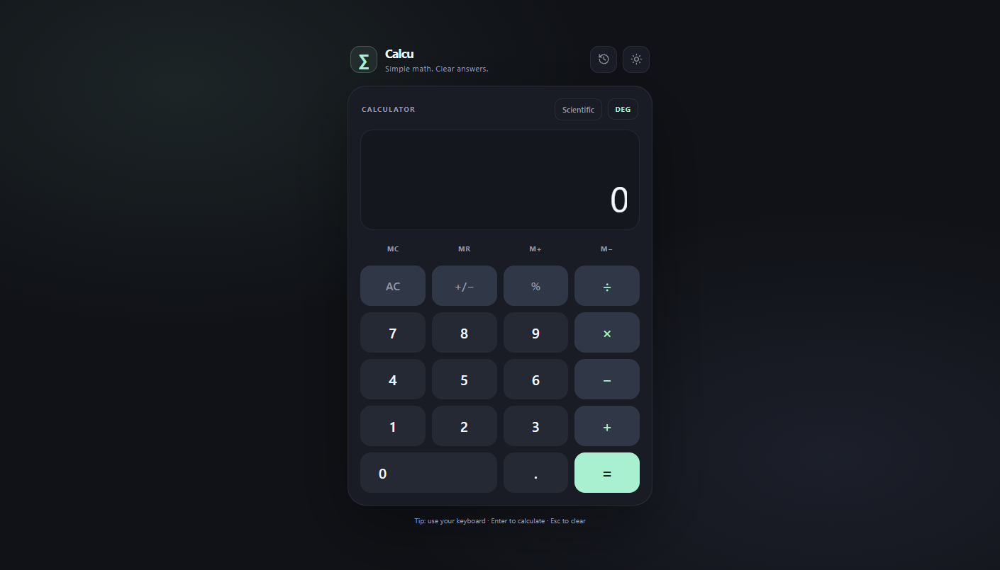

<div align="center">

# 🧮 Calcu

### *Simple math. Clear answers.*

A clean, responsive **scientific calculator** that runs right in your browser: trig, logs, memory, history, and light/dark themes. No installation, no build step.

[](https://calculator-7rgb.onrender.com)


**[🌐 Live Calculator](https://calculator-7rgb.onrender.com)** · **[🐛 Report Bug](https://github.com/digvijay165/calculator/issues)** · **[✨ Request Feature](https://github.com/digvijay165/calculator/issues)**

<br>

<a href="https://calculator-7rgb.onrender.com">
  
</a>

<sub>👆 Click the preview to open the live calculator</sub>

</div>

---

## 📖 About

**Calcu** is a browser-based calculator with a modern, minimal design. It handles everyday arithmetic and switches to a **scientific mode** for trigonometry, logarithms, exponentials, and more. Your recent calculations are saved, so you can pick up right where you left off.

It's a single `index.html` file with **zero dependencies**: just open it and calculate.

> 🔗 **Try it live:** [calculator-7rgb.onrender.com](https://calculator-7rgb.onrender.com)

---

## ✨ Features

| | Feature | Description |
| :---: | --- | --- |
| ➕ | **Everyday arithmetic** | Add, subtract, multiply, divide, percent, and +/− with full expression entry |
| 🔬 | **Scientific mode** | `sin` `cos` `tan`, inverse trig (`asin` `acos` `atan`), `√`, `log`, `ln`, `exp`, `abs`, and factorials |
| 📐 | **DEG / RAD modes** | Switch angle units with one tap |
| π | **Constants** | Built-in **π** and **e** |
| 💾 | **Memory controls** | `MC` · `MR` · `M+` · `M−` |
| 🕘 | **History** | Your last **40 calculations**, saved in the browser; tap one to reuse it |
| 📋 | **Copy result** | Copy the answer to your clipboard |
| 🌗 | **Light & dark themes** | Toggle with the ☀️ button |
| ⌨️ | **Keyboard support** | Type naturally: numbers, operators, <kbd>Enter</kbd>, <kbd>Esc</kbd>, <kbd>Backspace</kbd> |
| 📱 | **Responsive** | Adapts smoothly to phones, tablets, and desktops |

---

## ⌨️ Keyboard Shortcuts

| Key | Action |
| --- | --- |
| <kbd>0</kbd>–<kbd>9</kbd> <kbd>.</kbd> | Enter numbers |
| <kbd>+</kbd> <kbd>-</kbd> <kbd>*</kbd> <kbd>/</kbd> <kbd>%</kbd> | Operators |
| <kbd>Enter</kbd> | Calculate |
| <kbd>Esc</kbd> | Clear the current entry |
| <kbd>Backspace</kbd> | Delete the last character |

---

## 🧭 How to Use

1. Open the **[live calculator](https://calculator-7rgb.onrender.com)**
2. Tap buttons or type with your keyboard
3. Select **Scientific** to show the scientific functions
4. Use **DEG / RAD** to change the angle mode
5. Open **🕘 History** to revisit a recent calculation
6. Switch themes with the **☀️** button

---

## 🛠️ Tech Stack

- **HTML5**: calculator layout and structure
- **CSS3**: responsive design and light/dark themes
- **Vanilla JavaScript**: expression parsing, scientific functions, memory, and history
- **Web Storage API**: saves history and preferences
- **Render**: static hosting

---

## 📁 Project Structure

```
calculator/
├── index.html               # The complete app (markup, styles, and logic)
├── calculator-screenshot.png
└── README.md
```

---

## 🚀 Run Locally

No installation needed: clone it and open it.

```bash
git clone https://github.com/digvijay165/calculator.git
cd calculator
```

Then open `index.html` in any modern browser.

---

## 🌐 Deployment

Calcu is deployed as a **Render Static Site** and redeploys on every push to `main`.

| Setting | Value |
| --- | --- |
| Live URL | [calculator-7rgb.onrender.com](https://calculator-7rgb.onrender.com) |
| Branch | `main` |
| Build command | *None* |
| Publish directory | `.` |

It also works on GitHub Pages, Netlify, or Vercel without any configuration.

---

## 🗺️ Roadmap

- [ ] Unit and currency converter
- [ ] Graph plotting for functions
- [ ] Programmer mode (binary, hex, octal)
- [ ] Installable offline app (PWA)

---

## 🤝 Contributing

Contributions, issues, and feature requests are welcome!

1. Fork the project
2. Create your branch (`git checkout -b feature/AmazingFeature`)
3. Commit your changes (`git commit -m "Add AmazingFeature"`)
4. Push to the branch (`git push origin feature/AmazingFeature`)
5. Open a Pull Request

---

## 👤 Author

**Digvijay Singh**
- GitHub: [@digvijay165](https://github.com/digvijay165)
- Portfolio: [digvijay165.github.io/portfolio](https://digvijay165.github.io/portfolio/)

---

<div align="center">

⭐ **If you find Calcu useful, give it a star!** ⭐

Made with ❤️ by [Digvijay Singh](https://github.com/digvijay165)

</div>
